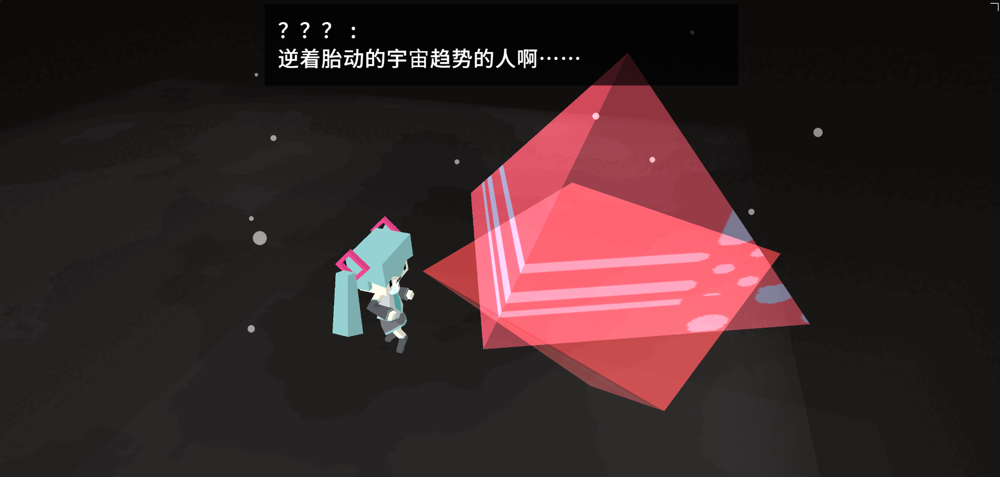
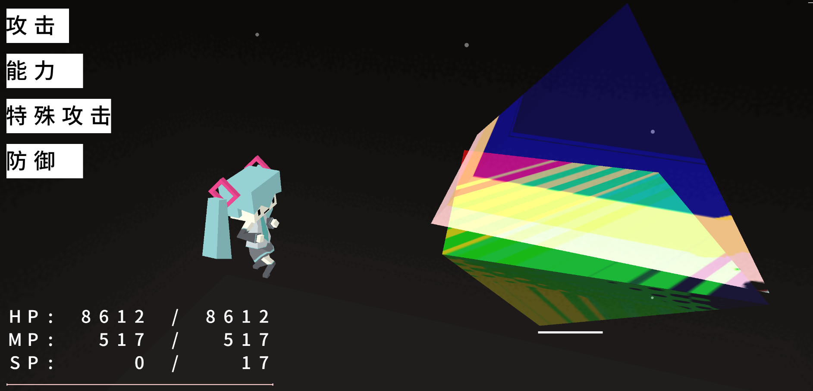
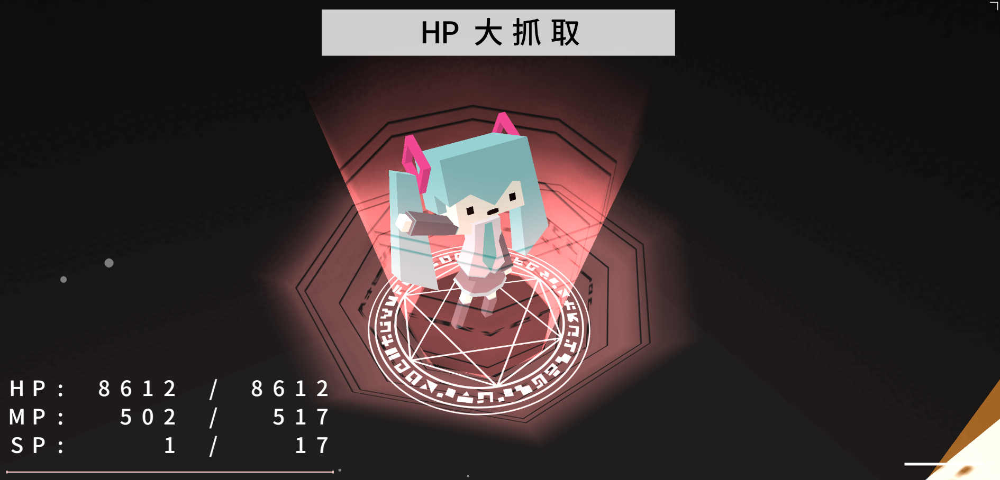

# MikuMiku Fantasy 汉化版
一款有趣的以初音未来为主题的RPG游戏，主要为初音未来与神秘三棱体战斗\
我做这个的汉化就是因为原版只提供了英语和日语，而且英语只是部分地方有，当时我受不了就这样了\
原版网站：https://aidn.jp/mf \
*（可惜的是原作者只做了试玩版，完整版毫无进展）*

原作者：[daniwellP](https://aidn.jp)\
汉化：[毕泽A2](https://github.com/bzA2)

## 游戏截图

## 其他说明
- 这个汉化版仅仅更改了游戏内的文字以及一小部分跳转代码（方便跳转到原作者网站，而非本人的网站），并未更改游戏玩法等核心内容，**欢迎在Issues中提跟汉化有关的问题**，我无法修复游戏本身的Bug
- **渣翻警告！** 由于我的翻译经验问题，很多地方我用了机翻加上润色，所以会影响游玩体验，真的很抱歉！
- **请勿将本游戏用于商业用途！**
- **请不要提交跟修改游戏玩法等核心内容有关的代码**

## DEMO
https://bza2.github.io/mikumikufantasy_chinese